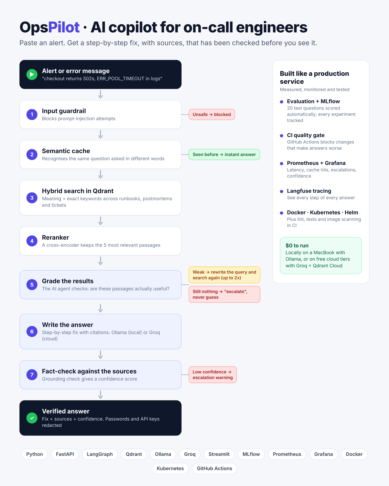

# OpsPilot

An AI copilot for on-call engineers. Paste an alert or error message and OpsPilot finds the
right runbook, postmortem or past ticket, and gives you a step-by-step fix with a source for
every step. If the documents don't cover the problem, it says so instead of guessing.

**Live demo:** https://opspilot-faiz.streamlit.app



## Why I built it

When something breaks in production, the fix is usually written down somewhere. The hard part
is finding it quickly, under pressure, across runbooks, old postmortems and tickets. General
chatbots don't solve this. They don't know your systems, and they sound just as confident
when they're wrong.

OpsPilot only answers from your own documentation, checks its answer before showing it, and
tells you when to escalate.

## How it works

1. **Guardrail:** blocks prompt-injection attempts.
2. **Semantic cache:** if the same question was asked before (even in different words), the answer comes back instantly.
3. **Hybrid search:** Qdrant searches by meaning *and* by exact keywords, so both "database is overloaded" and `ERR_POOL_TIMEOUT` match.
4. **Reranking:** a cross-encoder keeps the 5 most relevant passages.
5. **Self-correction:** a LangGraph agent grades the results and rewrites the query if they're weak (up to twice). If nothing relevant turns up, it recommends escalation.
6. **Answer:** a step-by-step fix with `[1]`-style citations.
7. **Fact-check:** the answer is compared against the sources. Anything that can't be verified is listed for the engineer to double-check, and secrets are redacted.

## Running it in production style

- **Evaluation:** 20 test questions scored automatically (retrieval hit rate, faithfulness, correctness), with every run tracked in MLflow.
- **CI quality gate:** a GitHub Actions workflow runs the evaluation on pull requests and fails if answer quality drops.
- **Monitoring:** Prometheus metrics and a ready-made Grafana dashboard (latency, cache hits, escalations, confidence).
- **Deployment:** Docker Compose for local use, a Helm chart for Kubernetes, and Streamlit Community Cloud for the public demo.

## Tech stack

| Area | Tools |
|---|---|
| AI | LangGraph, LangChain, Qdrant, FastEmbed, Ollama (`qwen2.5:7b`), Groq (`openai/gpt-oss-120b`) |
| Backend | Python 3.12, FastAPI, Pydantic, uv |
| UI | Streamlit |
| MLOps | MLflow, Prometheus, Grafana, Langfuse, Locust |
| DevOps | Docker, Kubernetes, Helm, Terraform, GitHub Actions |

Everything runs on free tools and free tiers. No credit card needed.

## Quick start (local)

You need [Docker Desktop](https://www.docker.com/products/docker-desktop/),
[Ollama](https://ollama.com) and [uv](https://docs.astral.sh/uv/).

```bash
git clone https://github.com/Faiz-Hussain650/opspilot.git
cd opspilot
ollama pull qwen2.5:7b
make setup
make up
```

Then open:

| Service | URL |
|---|---|
| Chat UI | http://localhost:8501 |
| API docs | http://localhost:8000/docs |
| Grafana | http://localhost:3000 (admin / admin) |
| MLflow | http://localhost:5001 |

Useful commands:

```bash
make ask Q="redis is rejecting writes with OOM command not allowed"
make test     # unit tests, no Docker or LLM needed
make eval     # run the evaluation and log it to MLflow
make help     # everything else
```

## Cloud mode

Set `OPSPILOT_MODE=cloud` and OpsPilot uses Groq for the LLM and Qdrant Cloud for search,
which is how the live demo runs. The step-by-step setup, including deploying to Streamlit
Community Cloud, is in [docs/GUIDE.md](docs/GUIDE.md).

## Project structure

```
src/opspilot/       core package: agent, API, retrieval, guardrails, cache
ui/                 Streamlit app
data/               sample knowledge base (runbooks, postmortems, tickets)
evaluation/         test questions and the evaluation runner
tests/              unit tests
monitoring/         Prometheus and Grafana config
k8s/                Helm chart for Kubernetes
.github/workflows/  CI, evaluation gate and image publishing
docs/               setup guide and architecture notes
```

## About the data

The knowledge base describes **Nimbus Shop**, a made-up online store. All the runbooks,
postmortems and tickets were written for this project. To use your own documents, point
`KNOWLEDGE_BASE_DIR` at a folder of Markdown, text or PDF files.

## Documentation

- [docs/GUIDE.md](docs/GUIDE.md): full setup, from a fresh Mac to the cloud
- [docs/ARCHITECTURE.md](docs/ARCHITECTURE.md): how each part works and why it's built that way

## License

MIT
