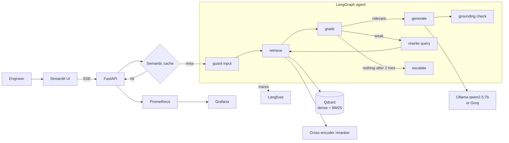

# OpsPilot

**An agentic RAG copilot for on-call engineers.** Paste an alert or error message and OpsPilot
searches your runbooks, postmortems and past incident tickets, checks its own search results,
retries with a better query when they're weak, and answers with step-by-step fixes and
citations. If the sources don't support an answer, it says so and tells you to escalate.

It runs **completely free**: locally on a MacBook (Ollama + Docker), or on free cloud tiers
(Groq + Qdrant Cloud + Streamlit Community Cloud). One environment variable switches between the two.

```
You:      checkout-service is returning 502s and logs say ERR_POOL_TIMEOUT
OpsPilot: Summary: the checkout DB connection pool is exhausted [1]...
          Immediate steps:
          1. Check whether this started after a deploy and roll back first [2]
          2. Look for long-running queries and cancel those over 60s [1] ...
          grounded · confidence 92% · 4.1s
```

---

## Why it's interesting

| Capability | How |
|---|---|
| **Hybrid search** | Dense embeddings (bge-small) + BM25 sparse vectors, fused with Reciprocal Rank Fusion inside Qdrant. Exact error codes *and* paraphrases both match. |
| **Reranking** | A cross-encoder re-scores the top 20 candidates and keeps the best 5. |
| **Agentic / corrective RAG** | A LangGraph state machine grades its own retrieval and rewrites the query (up to 2 times) before answering. |
| **Grounding check** | A second LLM pass verifies every claim against the sources; low confidence triggers an escalation flag. |
| **Citations** | Every statement points back to the passage it came from. |
| **Semantic cache** | Near-duplicate questions ("checkout 502s" / "502 errors on checkout") are answered instantly from a Qdrant-backed cache. |
| **Guardrails** | Prompt-injection blocking on input, secret redaction (passwords, API keys, tokens) on output. |
| **Streaming** | Server-Sent Events from FastAPI; the UI shows agent steps live and streams the answer token by token. |
| **Observability** | Prometheus metrics + a pre-built Grafana dashboard; optional Langfuse LLM tracing. |
| **Evaluation** | Golden dataset, retrieval metrics (hit rate, MRR), LLM-as-judge (faithfulness, correctness), results tracked in MLflow. |
| **CI/CD for LLM quality** | A GitHub Actions gate fails pull requests that make answers worse. Plus lint, tests, Trivy image scanning and multi-arch image publishing. |
| **Runs anywhere** | Docker Compose, Kubernetes (Helm chart for kind), Streamlit Cloud, optional Cloud Run via Terraform. |

## Architecture



| | Local mode | Cloud mode |
|---|---|---|
| LLM | Ollama `qwen2.5:7b` on the Mac GPU | Groq `llama-3.3-70b-versatile` |
| Vector DB | Qdrant in Docker | Qdrant Cloud (free 1 GB cluster) |
| UI | Streamlit in Docker | Streamlit Community Cloud |
| Tracing | optional Langfuse | Langfuse Cloud (free Hobby plan) |
| Cost | $0 | $0, no credit card |

## Tech stack

**AI:** LangGraph · LangChain · Ollama · Groq · FastEmbed (ONNX) · Qdrant · cross-encoder reranking
**Backend:** Python 3.12 · FastAPI · Pydantic v2 · Server-Sent Events · uv
**MLOps:** MLflow · LLM-as-judge evaluation · Langfuse · Prometheus · Grafana · Locust
**DevOps:** Docker · Docker Compose · Kubernetes (kind) · Helm · Terraform · GitHub Actions · GHCR · Trivy
**Quality:** pytest · Ruff · pre-commit

## Quick start (local, about 20 minutes on a MacBook)

Prerequisites: Docker Desktop, [Ollama](https://ollama.com), [uv](https://docs.astral.sh/uv/).
New to these? **[docs/GUIDE.md](docs/GUIDE.md) walks through everything from a fresh Mac.**

```bash
ollama pull qwen2.5:7b          # ~4.7 GB, one time
make setup                      # Python deps + .env
make up                         # builds and starts 6 containers
```

| Open | URL |
|---|---|
| Chat UI | http://localhost:8501 |
| API docs (Swagger) | http://localhost:8000/docs |
| Grafana dashboard | http://localhost:3000 (admin / admin) |
| MLflow | http://localhost:5001 |
| Prometheus | http://localhost:9090 |
| Qdrant dashboard | http://localhost:6333/dashboard |

```bash
make ask Q="redis is rejecting writes with OOM command not allowed"
make eval          # run the evaluation suite, results in MLflow
make help          # every command
```

## The four phases

The project is built in layers. Each one works on its own; **[docs/GUIDE.md](docs/GUIDE.md)** has
the step-by-step instructions and **[docs/ARCHITECTURE.md](docs/ARCHITECTURE.md)** explains the
concepts behind every component.

1. **Core RAG**: agent, API, UI, Qdrant, Docker Compose.
2. **MLOps**: evaluation + MLflow, Prometheus/Grafana, guardrails, load testing.
3. **Cloud**: Groq, Qdrant Cloud, Langfuse, public Streamlit demo, GitHub Actions (CI, eval gate, image publishing).
4. **Kubernetes**: kind cluster + Helm chart. Bonus: Cloud Run with Terraform.

## Evaluation results

Run `make eval` and paste your numbers here. Example layout:

| Metric | qwen2.5:7b (local) | llama-3.3-70b (Groq) |
|---|---|---|
| Retrieval hit rate | - | - |
| MRR | - | - |
| Faithfulness (judge) | - | - |
| Correctness (judge) | - | - |
| Behaviour accuracy (escalate / block) | - | - |
| p50 latency | - | - |

## API

| Method | Path | What it does |
|---|---|---|
| `POST` | `/chat` | Ask a question, get the full answer as JSON |
| `POST` | `/chat/stream` | Same, as Server-Sent Events (`step`, `token`, `final`) |
| `POST` | `/ingest/upload` | Upload a `.md`, `.txt` or `.pdf` and index it |
| `POST` | `/ingest/reindex` | Rebuild the index from `data/knowledge_base` |
| `GET` | `/stats` | Indexed chunks, services, model in use |
| `DELETE` | `/cache` | Clear the semantic cache |
| `GET` | `/health`, `/ready` | Liveness / readiness (checks Qdrant and the LLM) |
| `GET` | `/metrics/` | Prometheus metrics |

```bash
curl -s localhost:8000/chat -H 'content-type: application/json' \
  -d '{"question": "pod stuck in CrashLoopBackOff", "service": "platform"}' | jq .answer
```

## Project structure

```
opspilot/
├── src/opspilot/
│   ├── agent/            # LangGraph graph, nodes, prompts, routing
│   ├── api/main.py       # FastAPI app
│   ├── ingestion/        # loaders (md/txt/pdf) and structure-aware chunker
│   ├── config.py         # all settings, local/cloud mode
│   ├── embeddings.py     # FastEmbed dense, sparse, reranker
│   ├── vectorstore.py    # Qdrant: hybrid search, cache collection
│   ├── retrieval.py      # hybrid search + rerank
│   ├── cache.py          # semantic cache
│   ├── guardrails.py     # injection detection, secret redaction
│   ├── service.py        # end-to-end orchestration + streaming
│   └── metrics.py        # Prometheus metrics
├── ui/                   # Streamlit app (API or in-process backend)
├── data/knowledge_base/  # runbooks, postmortems, tickets (fictional "Nimbus Shop")
├── evaluation/           # golden dataset, metrics, eval runner
├── tests/                # pytest suite (no Docker or LLM needed)
├── monitoring/           # Prometheus config, Grafana dashboard
├── loadtest/             # Locust
├── docker/               # Dockerfiles
├── k8s/                  # kind config + Helm chart
├── deploy/gcp-cloudrun/  # optional Terraform for Cloud Run
├── .github/workflows/    # CI, eval gate, release
└── docs/                 # guide, architecture, LinkedIn post
```

## Configuration

Everything is an environment variable (see [.env.example](.env.example)). The important ones:

| Variable | Default | Meaning |
|---|---|---|
| `OPSPILOT_MODE` | `local` | `local` (Ollama) or `cloud` (Groq) |
| `OLLAMA_MODEL` | `qwen2.5:7b` | Any Ollama chat model |
| `GROQ_MODEL` | `llama-3.3-70b-versatile` | Any Groq chat model |
| `TOP_K` / `CANDIDATE_K` | `5` / `20` | Passages kept after / before reranking |
| `RERANK_ENABLED` | `true` | Turn the cross-encoder off to compare in MLflow |
| `MAX_QUERY_REWRITES` | `2` | Corrective-RAG retry budget |
| `CACHE_SIMILARITY_THRESHOLD` | `0.92` | How similar a question must be to hit the cache |

## About the data

The knowledge base describes **Nimbus Shop**, a fictional e-commerce company. Every runbook,
postmortem and ticket was written for this project, so the repository is safe to publish.
Point `KNOWLEDGE_BASE_DIR` at your own markdown/PDF folder to use real documents.

## License

MIT
